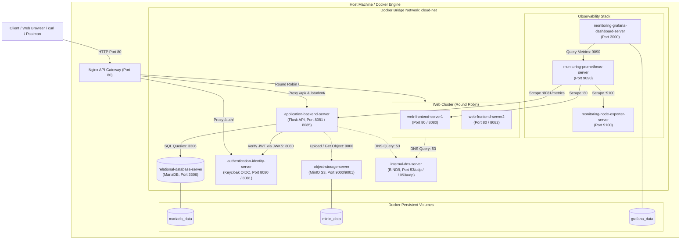

# TÀI LIỆU KIẾN TRÚC HỆ THỐNG MYMINICLOUD (ARCHITECTURE SPECIFICATION)

---

## 1. TỔNG QUAN HỆ THỐNG

**MyMiniCloud** là hệ thống mô phỏng hạ tầng Điện toán Đám mây (Cloud Infrastructure) thu nhỏ phục vụ đồ án học phần Cloud Computing. Dự án triển khai một hệ sinh thái dịch vụ đa tầng (Multi-tier Cloud Services) hoàn chỉnh chạy trên nền tảng **Docker** và **Docker Compose**, kết nối qua mạng nội bộ cô lập `cloud-net`.

Mỗi dịch vụ đảm nhiệm một vai trò chuyên biệt, mô phỏng các dịch vụ cốt lõi của các nhà cung cấp Cloud hàng đầu (AWS, GCP, Azure):
- **Web Hosting / Static Content Delivery**: Nginx Web Server (Web 1 & Web 2 hỗ trợ Round Robin cân bằng tải).
- **Application Server / Microservices**: Python Flask REST API kết nối cơ sở dữ liệu và tích hợp xác thực OIDC.
- **Relational Database Service (RDS)**: MariaDB với lưu trữ dữ liệu bền vững (Persistent Volume) và script khởi tạo tự động.
- **Identity and Access Management (IAM / IdP)**: Keycloak OIDC/OAuth2 Server phát hành và quản lý JWT token.
- **Object Storage Service (S3)**: MinIO hỗ trợ lưu trữ tệp tin nhị phân phi cấu trúc (ảnh, tài liệu PDF).
- **Domain Name System (Route 53)**: BIND9 DNS Server phân giải tên miền nội bộ `cloud.local`.
- **System Monitoring**: Prometheus (thu thập metrics) + Node Exporter (giám sát tài nguyên máy chủ).
- **Visualization & Observability**: Grafana với Data Source và Dashboard tự động cấu hình (Provisioning).
- **API Gateway & Load Balancer**: Nginx Reverse Proxy làm điểm tiếp nhận duy nhất (Single Point of Entry), định tuyến và cân bằng tải Round Robin.

---

## 2. BẢNG TRUY XUẤT YÊU CẦU (REQUIREMENTS TRACEABILITY MATRIX - RTM)

| STT | Chức năng / Dịch vụ | Container Name | Port nội bộ / Port Host | Nhiệm vụ kỹ thuật | Yêu cầu mở rộng (Điểm 10) |
|:---:|:---|:---|:---|:---|:---|
| 1 | **Web Frontend 1** | `web-frontend-server1` | 80 / 8080 | Phục vụ trang chủ và Blog tĩnh HTML/CSS | 3 bài viết blog cá nhân + điều hướng đồng nhất |
| 2 | **Web Frontend 2** | `web-frontend-server2` | 80 / 8082 | Bản sao Web Server phục vụ cân bằng tải | Phân biệt phiên bản phục vụ kiểm thử Round Robin |
| 3 | **Flask Application Backend** | `application-backend-server` | 8081 / 8085 | REST API, xử lý nghiệp vụ, kết nối DB, xuất Prometheus metrics | API `/student` đọc JSON 5 sinh viên; API `/api/students-db` đọc MariaDB; API `/secure` xác thực JWT |
| 4 | **Relational Database** | `relational-database-server` | 3306 / 3306 | Lưu trữ CSDL quan hệ MariaDB | Database `studentdb`, bảng `students`, script khởi tạo tự động, volume bền vững |
| 5 | **Identity & IAM (Keycloak)** | `authentication-identity-server` | 8080 / 8081 | OIDC Provider, xác thực tập trung | Realm `MyMiniCloud`, Client `flask-app`, User `sv01`, `sv02`, cấp JWT RS256 |
| 6 | **Object Storage (MinIO)** | `object-storage-server` | 9000 (API), 9001 (Console) | Lưu trữ Object S3-compatible | Buckets `profile-pics` (avatar), `documents` (PDF), kiểm tra truy xuất |
| 7 | **Internal DNS (BIND9)** | `internal-dns-server` | 53/udp / 1053/udp | Phân giải tên miền private zone `cloud.local` | Bản ghi A cho `web-frontend-server`, `app-backend`, `minio`, `keycloak` |
| 8 | **Monitoring (Prometheus)** | `monitoring-prometheus-server` | 9090 / 9090 | Thu thập metrics hệ thống qua chu kỳ scrape | Scrape targets: `node-exporter`, `app-backend`, `web-frontend-server` |
| 9 | **Node Exporter** | `monitoring-node-exporter-server` | 9100 / 9100 | Thu thập số liệu phần cứng host/container | Cung cấp metrics CPU, RAM, Network cho Prometheus |
| 10 | **Dashboard (Grafana)** | `monitoring-grafana-dashboard-server` | 3000 / 3000 | Trực quan hóa dữ liệu giám sát | Dashboard auto-provisioning 3 biểu đồ: CPU Usage, Memory, Network Traffic |
| 11 | **API Gateway / Proxy** | `api-gateway-proxy-server` | 80 / 80 | Điểm vào duy nhất, Reverse Proxy, Gateway | Định tuyến `/` -> Web, `/api/` -> Backend, `/student/` -> Backend `/student`, `/auth/` -> Keycloak |
| 12 | **Load Balancing** | `api-gateway-proxy-server` | 80 / 80 | Thuật toán Round Robin | Cân bằng tải luân phiên giữa `web-frontend-server1` và `web-frontend-server2` |

---

## 3. SƠ ĐỒ KIẾN TRÚC VÀ LUỒNG DỮ LIỆU (DATA FLOW & NETWORK TOPOLOGY)

---

## 4. CHI TIẾT CÁC CƠ CHẾ GIAO TIẾP VÀ BẢO MẬT

1. **Docker Service Discovery**:
   - Tất cả container tham gia vào user-defined bridge network `cloud-net`.
   - Các dịch vụ liên lạc trực tiếp bằng service name (ví dụ: `http://application-backend-server:8081`, `http://authentication-identity-server:8080`).
   - Không phụ thuộc vào IP động của container.

2. **Cơ chế Reverse Proxy & Path Stripping**:
   - Truy cập `/` hoặc `/blog/` -> Gateway chuyển tiếp Round Robin tới `web_cluster` (Web 1 và Web 2).
   - Truy cập `/api/*` -> Gateway chuyển tiếp tới `application-backend-server:8081/*` (loại bỏ tiền tố `/api/`).
   - Truy cập `/student/` hoặc `/student` -> Gateway chuyển tiếp tới `application-backend-server:8081/student`.
   - Truy cập `/auth/*` -> Gateway chuyển tiếp tới `authentication-identity-server:8080/`.

3. **Cơ chế Xác thực JWT OIDC chuẩn hóa**:
   - Client đăng nhập vào Keycloak lấy Access Token (RS256).
   - Khi Client gửi request kèm header `Authorization: Bearer <TOKEN>` tới endpoint `/secure` (hoặc `/api/secure`), Flask Backend không chỉ giải mã chuỗi mà tải Public Key từ JWKS Endpoint (`/realms/MyMiniCloud/protocol/openid-connect/certs`) để kiểm tra chữ ký số mật mã học, kiểm tra Issuer, Audience và Expiration time.

4. **Cơ chế Thu thập Metrics & Dashboard Provisioning**:
   - Flask API tích hợp `prometheus_client` xuất metrics chuẩn Prometheus tại endpoint `/metrics`.
   - Prometheus scrape định kỳ 15s các targets: Node Exporter, Flask App, Web Frontend.
   - Grafana tự động nạp Data Source Prometheus và tự động nạp Dashboard `System Health` qua provisioning folder, người dùng mở trình duyệt là thấy ngay biểu đồ mà không cần cấu hình bằng tay.

